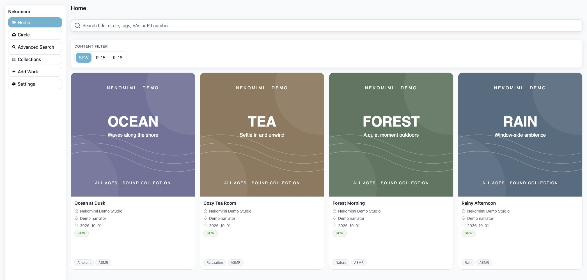
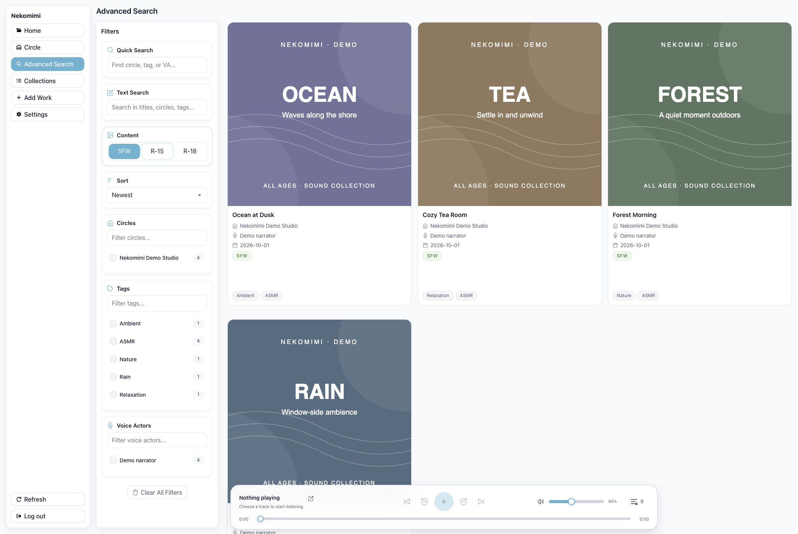
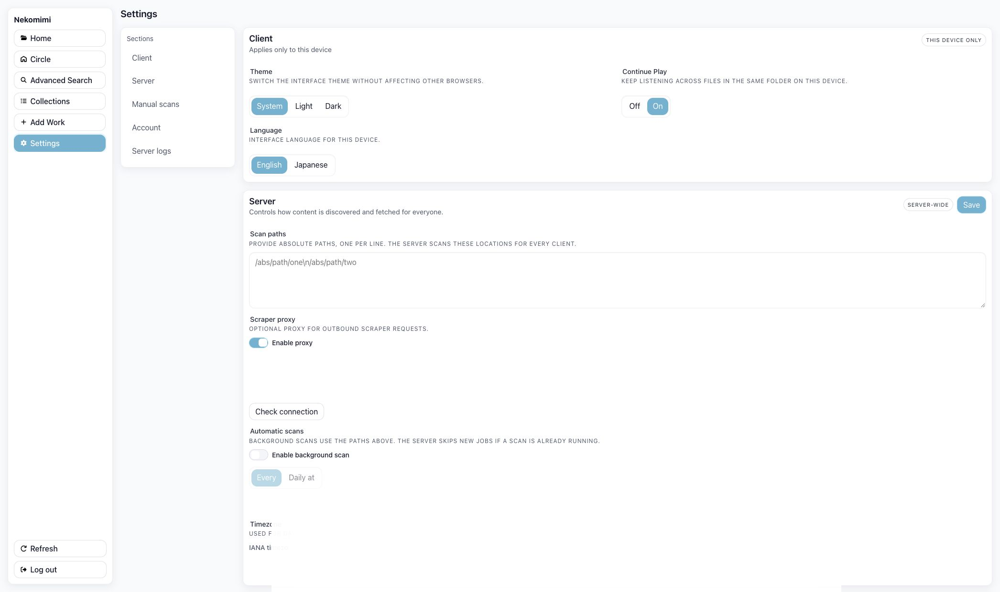

# Nekomimi

A self-hosted ASMR library and browser-based audio player. Keep your audio on your own server, browse your collection, and listen from desktop or mobile.



*Demo data is fictional.*

## Features

- Scan local folders and match works by RJ code.
- Import metadata from DLsite, with ASMROne and HVDB fallbacks.
- Search by title, circle, tags, voice actor, or RJ number.
- Organize works into manual collections or tag-based smart collections.
- Listen with an integrated audio player and playback queue.
- Choose which age ratings appear using independent SFW, R-15, and R-18 filters.
- Keep your library private with cookie-based login and a local SQLite database.

## More screenshots

### Advanced Search



### Settings



## Quick start

Requires **Node.js 20+**, **npm 9+**, and a local copy of the project source.

```bash
npm install
npm --prefix client install
npm run build
npm start
```

Open **http://localhost:3000**. On first launch, read the account setup token in the server terminal, select **Initialize admin**, verify the token, and create an account with a password of at least 12 characters.

1. Open **Settings → Library Paths** and add an absolute path to your media library.
2. Run **Scan Library**, or use **Add Work** to import a work manually.
3. Browse **Home**, search your collection, and open a work to play its audio.

## Development

Run these in separate terminals from the project root:

```bash
npm run dev:server
npm run dev:client
```

Open **http://localhost:5173**; Vite forwards API requests to the server on port 3000.

## Storage and deployment

Audio files stay in their original folders. Nekomimi stores its database, settings, and authentication files in `data/`, and managed artwork in `cover/`. Back up both directories. Use `DATA_DIR`, `COVER_DIR`, and `PORT` to override the defaults.

A Dockerfile and Compose configuration are included in the source. Create writable `data/` and `cover/` directories, mount your media library, and run the container with the intended UID/GID.

The running server provides interactive API documentation at **http://localhost:3000/api/docs**.

## Credits

Thanks to Kikoeru for the scraper code.