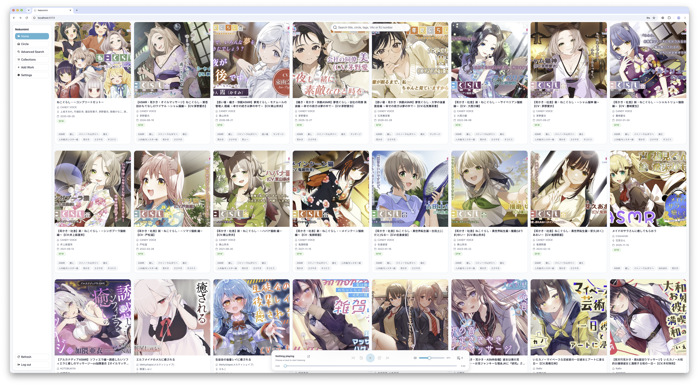
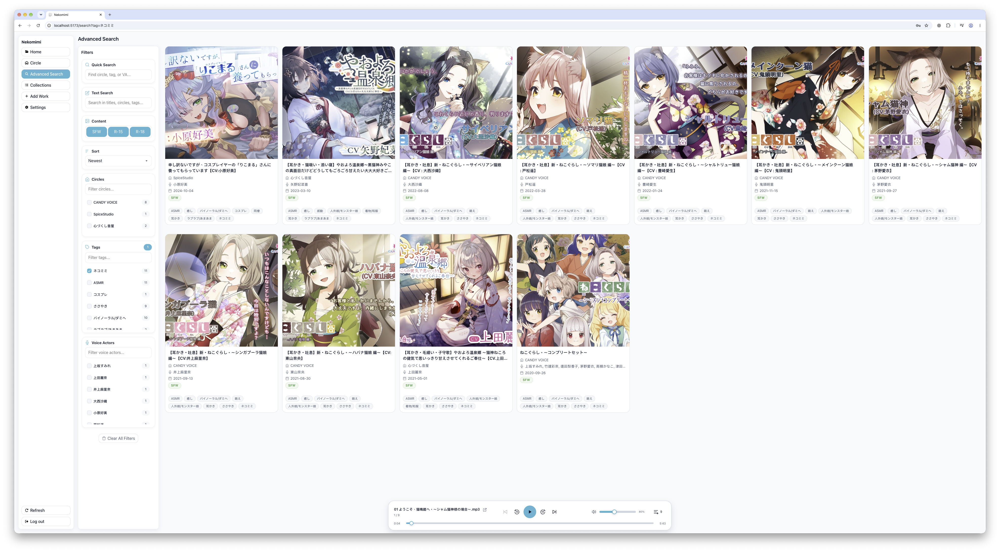
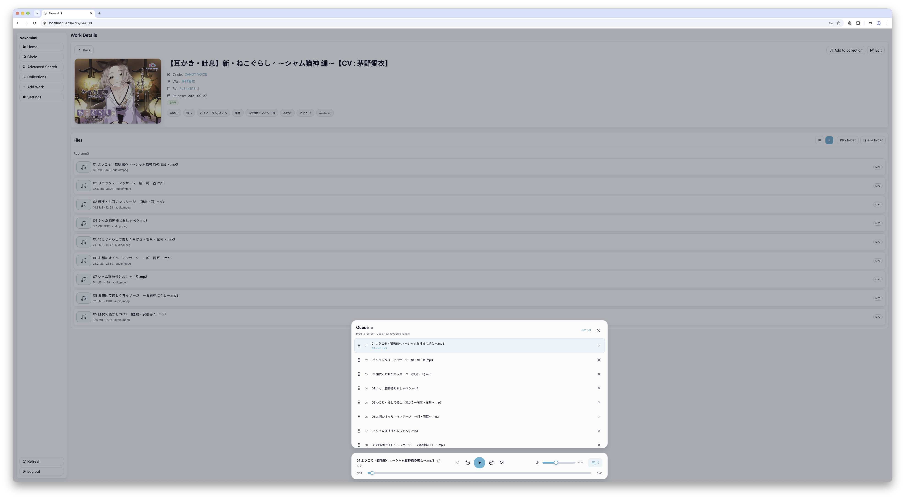
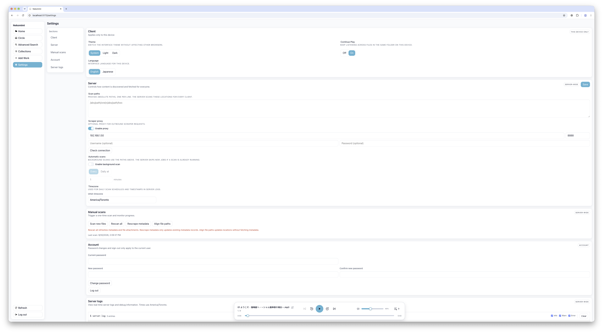

# Nekomimi

A self-hosted ASMR library and browser-based audio player. Keep your audio on your own server, browse your collection, and listen from desktop or mobile.



## Features

- Scan local folders and match works by RJ code.
- Import metadata from DLsite, with ASMROne and HVDB fallbacks.
- Search by title, circle, tags, voice actor, or RJ number.
- Organize works into manual collections or tag-based smart collections.
- Listen with an integrated audio player and playback queue.
- Choose which age ratings appear using independent SFW, R-15, and R-18 filters.
- Keep your library private with cookie-based login and a local SQLite database.

## More screenshots

### Advanced Search



### Work details and playback queue



### Settings



## Quick start with Docker (recommended)

Use the public image `ghcr.io/aurethiaveritas/nekomimi:edge` to run the server and web interface together. It supports AMD64 and ARM64. You only need Docker; building an image, installing Node.js, cloning the source, and signing in to GHCR are not required.

Run this from the directory where you want to store Nekomimi's data. Replace `/absolute/path/to/your/library` with your media directory:

```bash
mkdir -p data cover
docker pull ghcr.io/aurethiaveritas/nekomimi:edge
docker run -d \
  --name nekomimi \
  --restart unless-stopped \
  --user "$(id -u):$(id -g)" \
  -p 3000:3000 \
  --mount type=bind,source="$PWD/data",target=/data \
  --mount type=bind,source="$PWD/cover",target=/app/cover \
  --mount type=bind,source=/absolute/path/to/your/library,target=/library,readonly \
  ghcr.io/aurethiaveritas/nekomimi:edge
```

The `edge` tag tracks builds from `main`. Replace it with a published version tag to pin a release. See the [Docker guide](DOCKER.md#public-github-images) for Compose deployment and image tags.

Open **http://localhost:3000**. On first launch, get the account setup token from the container logs:

```bash
docker logs nekomimi
```

Select **Initialize admin**, verify the token, and create an account with a password of at least 12 characters.

1. Open **Settings → Library Paths** and add `/library` (the path inside the container).
2. Run **Scan Library**, or use **Add Work** to import a work manually.
3. Browse **Home**, search your collection, and open a work to play its audio.

Your database, settings, and accounts persist in `data/`; managed artwork persists in `cover/`. Back up both directories. Audio stays in your mounted library.

## Build your own Docker image (optional)

If you want to customize the application, clone the source and run this from the repository root:

```bash
docker build -t nekomimi-local .
```

Use the same `docker run` command above, replacing `ghcr.io/aurethiaveritas/nekomimi:edge` with `nekomimi-local`. Keep the data, cover, and media mounts.

## Build and run from source (optional)

Requires **Node.js 20+**, **npm 9+**, and a local copy of the project source.

```bash
npm install
npm --prefix client install
npm run build
npm start
```

Open **http://localhost:3000** and use the account setup token printed in the server terminal to initialize your admin account. For source deployments, configure the media directory's absolute host path in **Settings → Library Paths**.

## Development

Run these in separate terminals from the project root:

```bash
npm run dev:server
npm run dev:client
```

Open **http://localhost:5173**; Vite forwards API requests to the server on port 3000.

## Storage and deployment

Audio files stay in their original folders. Nekomimi stores its database, settings, and authentication files in `data/`, and managed artwork in `cover/`. Back up both directories. Use `DATA_DIR`, `COVER_DIR`, and `PORT` to override the defaults.

See the [Docker guide](DOCKER.md) for Compose, storage permissions, environment variables, and reverse proxy configuration.

The running server provides interactive API documentation at **http://localhost:3000/api/docs**.

## Documentation

- [HTTP API reference](API.md)
- [Docker deployment](DOCKER.md)
- [Testing guide](test/README.md)

## License

Nekomimi is licensed under the [GNU Affero General Public License v3.0](LICENSE) (AGPL-3.0-only).

## Credits

Thanks to Kikoeru for the scraper code.
